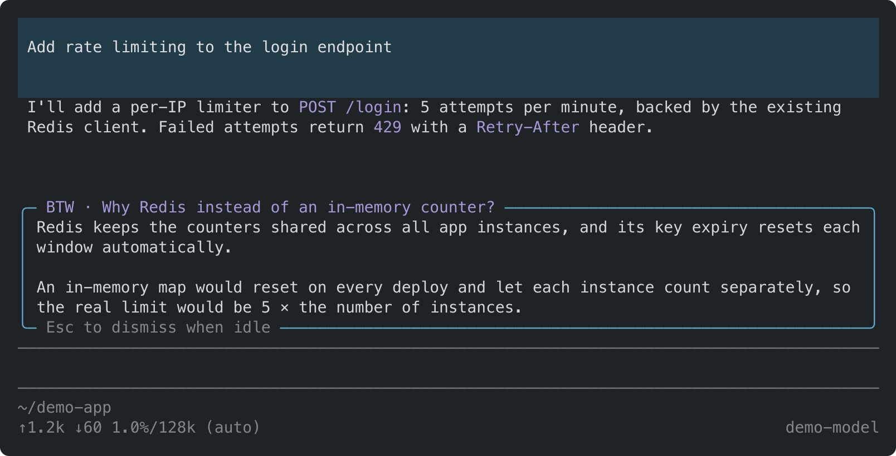
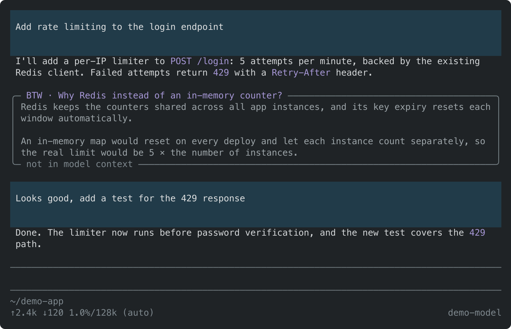

# `/btw` — side questions

Ask a quick question about the current conversation without interrupting the
main task or adding to its context.

```text
/btw Why did we choose this approach?
/btw --cancel
```

## Install

```sh
pi install npm:@tboon0/pi-btw
```

Requires Pi 1.5.2 or later; tested with Pi 1.6.0. Run `/reload` in existing
sessions. Remove any standalone installation of `btw.ts`, or the all-extensions
`pi-extensions` package, first to avoid duplicate commands.

The answer is pinned above the editor until you dismiss it:



Once dismissed, it stays in the transcript, marked as outside model context:



## Behavior

- Uses the currently selected model through Pi's configured provider and auth.
- Runs independently without aborting or steering the main task.
- Has no tools and cannot inspect files or make changes.
- Uses a bounded text snapshot of the active conversation, including compaction
  summaries and tool results. Older text may be omitted; images are not included.
- Saves answers as display-only entries in the session file once they leave the
  pinned box (Esc, a new `/btw`, tree navigation, or session shutdown), so an
  answer never shows twice. A hard crash loses an answer that is still pinned.
  Saved answers appear in the transcript in a muted bordered box labelled
  "not in model context", collapsed to 6 lines until expanded (Ctrl+O by
  default), and are excluded from future model context. They are not ephemeral
  or private from anyone with access to that session file.
- Each question is independent; earlier side answers are not included.
- Shows a spinner above the editor while the answer is pending, then pins the
  answer there in a bordered box (up to 15 lines) so main-agent output can't
  scroll it away. Press Esc with an empty editor while the agent is idle to
  dismiss it; while the agent runs, Esc still interrupts it as usual. A new
  `/btw` replaces the pinned answer.
- Run `/btw` with no question to read the full pinned answer in a scrollable
  overlay (↑/↓, PgUp/PgDn, Home/End; Esc closes it and keeps the answer pinned).
  It works while the agent runs.
- Runs one side question at a time, with a two-minute timeout. A second `/btw`
  is rejected until the first finishes; `/btw --cancel` stops the running one so
  you can ask again. It never touches the main task. Session shutdown or tree
  navigation also cancels it.
- Supports TUI and RPC mode, not print mode. Extra provider calls are billed but
  are not included in Pi's session cost totals.

## Tests

From this directory:

```sh
npm test -- /absolute/path/to/node_modules/@earendil-works/pi-coding-agent
```

The tests use Pi's native extension loader and mock model responses. They cover
context isolation, non-blocking requests, the loading widget, the pinned answer,
the reader overlay, the saved transcript entry, cancellation, shutdown, and
errors. Live provider responses and visual TUI rendering still need manual
verification.
